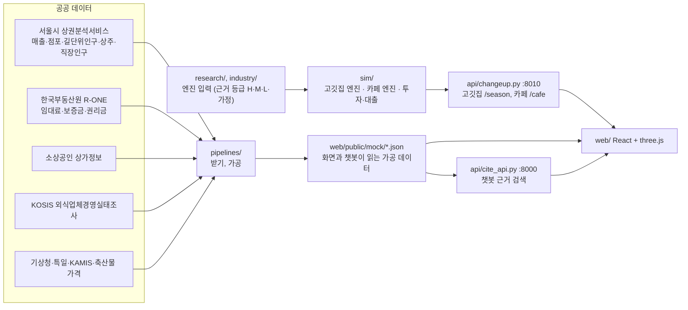

# 구조

## 전체 그림

## 계층

| 계층 | 폴더 | 역할 |
|---|---|---|
| 데이터 | `pipelines/`, `data/processed/` | 공공 API와 파일을 받아 구·행정동·상권 단위로 가공 |
| 연구 값 | `research/`, `industry/` | 엔진 입력. 값마다 출처 번호나 "가정" 표시. `ontology/sources.csv`는 출처 목록 |
| 엔진 | `sim/` | 고깃집(`engine.py`, `season.py`), 카페(`cafe/`), 투자·대출(`venture.py`) |
| API | `api/` | 엔진을 HTTP로 노출. 챗봇 검색 |
| 화면 | `web/src/mock/` | 4단계 흐름, 3D 가게, 챗봇 창 |

## 시뮬레이션

### 고깃집 (`sim/engine.py`, `sim/season.py`)
- **밤 하나:** 토요일 밤을 이산사건으로 돌립니다(SimPy). 손님 팀이 도착하고, 자리가 없으면 기다리거나 돌아가며, 앉으면 주문·식사·계산을 합니다. 직원 수와 테이블 수가 대기와 만족도에 영향을 줍니다.
- **한 달:** 밤 하나의 결과를 영업일과 요일·시간대 비율로 환산하고, 달력(방학, 공휴일), 날씨, 월세, 인건비를 더해 월 손익을 만듭니다.
- **시즌:** 6개월을 이어서 돌립니다. 현금, 평점, 후기 수, 인지도, 단골 비율이 달마다 이어지고, 현금이 바닥나면 폐업합니다.
- **달별 사건:** 매달 달력에 맞는 사건 하나가 고정으로 나옵니다(`research/events.yaml`의 `_night_decisions`, `months`). 선택지는 그날 밤의 결정(단체 예약 받기, 직원 대기 등)이나 월 단위 효과(손님 배수, 가격 배수)로 환산되어 월 손익에 더해집니다. 무작위 사건(날씨 등)은 별도입니다.
- **동네 반영:** 화면이 보낸 요일·시간대·연령 비율로 손님 모양이 바뀌고, 동네 한식 점포당 매출로 손님 규모를 보정합니다(`sim/store_input.py`).

### 카페 (`sim/cafe/`)
- 월 단위 결정론 모델입니다. 상권별 시간대·요일 비중, 좌석, 직원, 객단가로 월 손님과 매출을 계산합니다.
- 달별 사건 12개(`research/cafe/params.yaml`의 `season.scenario_points`)는 손님 배수, 객단가 배수, 붙잡는 비율, 비용, 만족도로 효과를 정의합니다.
- 월세 인상, 기계 고장 같은 사건은 시드와 달로 정해집니다. 자세한 규격은 [CAFE.md](CAFE.md).

## 챗봇 (`api/cite_api.py`, `api/ask_ext.py`)
- LLM을 쓰지 않습니다. 질문의 주제(월세, 경쟁, 날씨, 동네 인구 등)를 먼저 정하고, 그 주제의 근거 문장 중 유사도가 가장 높은 것을 그대로 돌려줍니다.
- 근거는 `web/public/mock/facts*.json`과 화면이 질문과 함께 보낸 값(평수, 월세, 시뮬레이션 결과, 선택한 동네)으로 즉석에서 만든 문장입니다.
- 질문의 핵심 낱말이 근거에 없으면 억지로 답하지 않습니다. 평가 질문은 `tests/ask_eval/questions.yaml`(49개).

## 화면 (`web/src/mock/`)
- `Mock.tsx`가 데이터를 불러오고 4단계를 잇습니다. 업종에 따라 고깃집 화면(`SimulateEngine.tsx`, `Builder.tsx`)과 카페 화면(`CafeSim.tsx`, `CafeBuild.tsx`)이 갈립니다.
- 3D는 `Scene3D.tsx`, `Parts3D.tsx`(고깃집), `CafeRoom3D.tsx`(카페)입니다. 확대하면 손님 쪽 앞벽이 흐려져 내부 배치가 보입니다.
- 데이터 로딩과 지역·동네 계산은 `area.ts`, 금액과 점검은 `model.ts`입니다.
